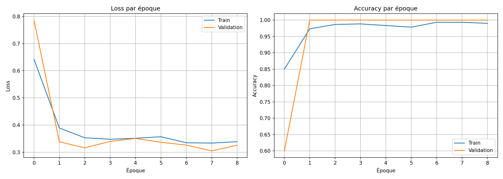
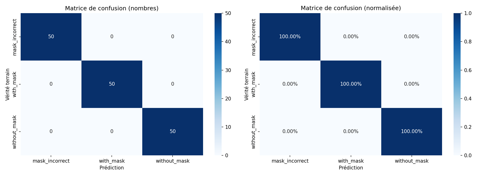
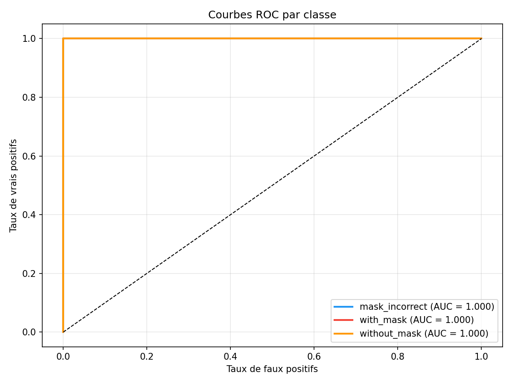
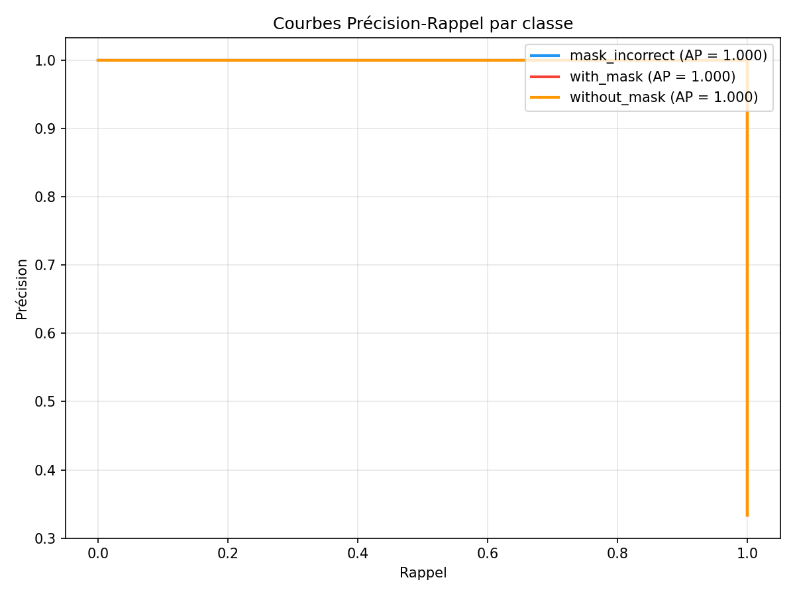

# Face Mask Detection : temps réel

Détection en temps réel du port du masque (**correct**, **incorrect**, **absent**) par webcam, image ou vidéo,
avec un détecteur de visages SSD et un classifieur **MobileNetV2** fine-tuné.

## Fonctionnement

```
Frame webcam ─► Détecteur de visages (OpenCV SSD ResNet-10)
             ─► Recadrage du visage ─► MobileNetV2 (transfer learning)
             ─► Lissage sur 5 frames ─► Affichage : vert / orange / rouge
```

- **Transfer learning** en deux temps : backbone gelé, puis fine-tuning complet
- Early stopping, `ReduceLROnPlateau`, augmentation de données
- Choix du backbone : `mobilenet_v2` (léger, temps réel) ou `resnet50`

## Résultats

| Courbes d'entraînement | Matrice de confusion |
|:---:|:---:|
|  |  |
| **ROC** | **Précision / Rappel** |
|  |  |

## Structure

| Fichier | Rôle |
|---------|------|
| `config.py` | Chemins, classes, hyperparamètres |
| `download_real_dataset.py`, `setup_real_dataset.py`, `prepare_data.py` | Téléchargement et découpage train/val/test |
| `create_dataset_webcam.py` | Création de son propre jeu de données par webcam |
| `dataset.py`, `model.py` | DataLoaders et modèle |
| `train.py`, `evaluate.py` | Entraînement et évaluation |
| `detect.py` | Détection temps réel (webcam / image / vidéo) |
| `mask_detection.ipynb` | Notebook d'exploration |

## Utilisation

```bash
pip install -r requirements.txt
python download_real_dataset.py && python prepare_data.py   # données dans data/
python train.py                                              # modèle dans checkpoints/best_model.pth
python evaluate.py
python detect.py                                             # webcam
```

Les données et le modèle entraîné (`checkpoints/`) ne sont pas versionnés à cause de leur taille.

## Auteure

**Maha El Yamni**, [LinkedIn](https://www.linkedin.com/in/maha-el-yamni/) · [GitHub](https://github.com/maha-yam)
